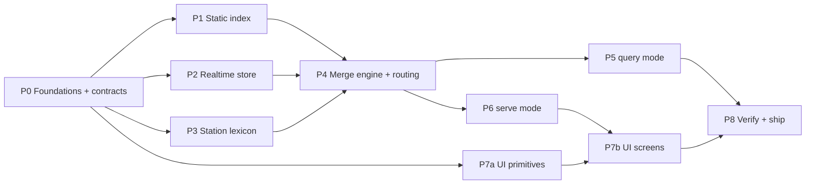

# Implementation Plan — Brisbane Realtime Trains

- **Source of truth:** `SPEC.md`. This plan orders the work and pins the contracts that let it run in parallel; it does not restate design rationale. Section references (§) point into the spec.
- **Toolchain (verified on this machine):** Go 1.26.5 windows/amd64, Node 22.23.2 + npm. No Bun, no `protoc` (not needed — bindings are pre-generated). One binary: `trains.exe` on Windows, with query and serve modes (§4).
- **Module path:** `trains`. No remote exists yet; renaming later is one `go mod edit -module` plus an import rewrite.

**Tracking:** tick a box (`[x]`) only when its *Done when* criterion has been observed, not when the code is written. A phase is complete when every box in it is ticked. Items without a *Done when* are complete when they compile and are exercised by a later item that has one.

---

## Lanes and dependencies



- **P0 is strictly sequential** and must land first: it freezes the types and the wire contract everything else codes against.
- **After P0, four lanes run in parallel:** P1 static, P2 realtime, P3 lexicon, P7a UI primitives. None depends on another's implementation, only on P0 types.
- **P4 is the integration point** and the highest-risk phase. One owner.
- **P5 and P6 run in parallel** once P4's `Service` API is callable. They live in separate packages (`cmd/trains/query`, `cmd/trains/serve`) and share only `cmd/trains/main.go`, a few lines of dispatch: P5 creates it with query mode wired, and P6 adds the `serve` case when its package lands. Neither waits on the other, and no placeholder code is needed.

---

## P0 — Foundations and frozen contracts

Blocks everything. Small, but every later lane depends on its exact shapes.

- [x] **0.1** `go mod init trains`, `go 1.26`; add `github.com/MobilityData/gtfs-realtime-bindings/golang/gtfs v1.0.0`
  - Files: `go.mod`, `go.sum`
  - Done when: `go build ./...` succeeds
- [x] **0.2** Public domain types exactly as §3.5: `StopID`, `StationID`, `TripID`, `RouteID`, `ServiceID`, `ShapeID` (distinct string types), `Date`, `Position`, `TimeSource`, `Punctuality`, `Journey`, `Leg`, `Call`, `Change`, `VehicleFix`, `Alert`
  - Files: `gtfsrail/types.go`
  - Done when: compiles; enums have `String()`
- [x] **0.3** JSON wire contract (below) as Go DTOs plus `FromJourney`/`FromLeg` converters, mirrored as TS types. Shared by serve mode and `trains --json`, so it lives in the library, not under either mode's package
  - Files: `gtfsrail/wire/`, `web/src/api/types.ts`
  - Done when: both compile; field names identical
- [x] **0.4** `web/` scaffold: Vite + React + TS, `web/embed.go` with `//go:embed all:dist`, committed `web/dist/.gitkeep`
  - Files: `web/`
  - Done when: `go build ./...` passes with an empty `dist`
- [x] **0.5** `cmd/capture`: fetch all three realtime feeds at one instant, write raw `.pb`
  - Files: `cmd/capture/`
  - Done when: writes `testdata/rt/<ts>/{tu,vp,alerts}.pb`
- [x] **0.6** Export the 154 real rail stations (`id,name,lat,lon`) from the current feed, so P3 can test against real names without waiting for P1
  - Files: `testdata/stations.csv`
  - Done when: 154 rows; P1.9 later asserts the parser produces the identical set

`cmd/mkfixture` is raw-CSV only (no dependency on the P1 parser), so it shipped in P0 to produce `testdata/stations.csv`; 1.9 covers the fixture checks.

### Wire contract (frozen in P0)

Library types stay idiomatic Go (`time.Time`, `time.Duration`). `gtfsrail/wire` converts them to DTOs at the edge, for both serve mode and `trains --json`. Conventions: camelCase keys, timestamps as RFC3339 with the `+10:00` offset, durations as integer **seconds**, absent values as `null` — never omitted. **The authoritative copies are `gtfsrail/wire/wire.go` and `web/src/api/types.ts`;** the summary below is for orientation.

```ts
type Punctuality = 'early' | 'onTime' | 'late' | 'veryLate' | 'skipping' | 'cancelled' | 'scheduled';
type Position    = 'passed' | 'current' | 'upcoming';
type TimeSource  = 'observed' | 'predicted' | 'projected' | 'scheduled';

interface Station    { id: string; name: string; lat: number; lon: number; aliases: string[] }
interface Call       { stationId: string; name: string; platform: string | null;
                       scheduled: string; expected: string; actual: string | null;
                       position: Position; source: TimeSource; skipped: boolean }
interface VehicleFix { lat: number; lon: number; atSequence: number; atIndex: number | null;
                       status: 'STOPPED_AT' | 'IN_TRANSIT_TO' | 'INCOMING_AT'; observedAt: string; stale: boolean }
interface Alert      { id: string; header: string; description: string;
                       effect: string; cause: string; activeUntil: string | null }
interface Leg        { tripId: string; serviceDate: string /* YYYY-MM-DD */; runNumber: string | null;
                       routeName: string; routeColor: string; headsign: string;
                       calls: Call[]; board: number; alight: number;
                       punctuality: Punctuality; delaySeconds: number;
                       vehicle: VehicleFix | null; alerts: Alert[]; shapeId: string | null }
interface Change     { stationId: string; name: string; bufferSeconds: number; tight: boolean }
interface Journey    { legs: Leg[]; change: Change | null; depart: string; arrive: string; punctuality: Punctuality }

interface JourneysResponse { origin: Station; destination: Station; journeys: Journey[];
                             generatedAt: string; dataAgeSeconds: number; degraded: boolean }
interface LegResponse      { leg: Leg; generatedAt: string; dataAgeSeconds: number; degraded: boolean }
interface ShapeResponse    { shapeId: string; points: [number, number][] /* [lat, lon] */ }
interface StationsResponse { stations: Station[] }
interface ErrorResponse    { error: 'ambiguous' | 'unknown_station' | 'not_found' | 'bad_request';
                             message: string; candidates?: Station[] }
```

- `ADDED` trips have `shapeId: null` (no static trip to take one from); the UI hides the diagram for them.
- `/api/journeys` with an ambiguous station returns `400` + `ErrorResponse{error:'ambiguous', candidates}` — the UI's disambiguation list is driven by this, not a second endpoint.
- `/api/legs/{tripId}?date=&from=&to=` — optional `from`/`to` station IDs set `board`/`alight`; without them the whole trip is returned with `board=0`, `alight=last`.
- `Station.aliases` carries the curated aliases (§3.7), so the UI's client-side picker matches them without a second copy of the alias table.
- `Change` has no `infeasible` flag: pairings are made on expected times, so a connection eroded below 4 min is dropped and the next feasible pairing chosen before anything is emitted (§3.6).
- `VehicleFix.atIndex` saves the UI from searching `calls` for `atSequence`.

---

## P1 — Static rail index (`gtfsrail/internal/gtfs`, `gtfsrail/internal/geo`)

- [x] **1.1** `Secs` parser for `H+:MM:SS`, accepting hours ≥ 24 (§2.2: max `26:16:00`)
  - Done when: rejects malformed input; `26:16:00` → 94,560
- [x] **1.2** Streaming CSV reader: header-indexed columns (never positional), CRLF (verified present), **whitespace-trimmed fields** — `stop_lat` is `' -27.470552'` with a leading space in the real feed
  - Done when: parses real `stops.txt` without float errors
- [x] **1.3** Filtered pass in dependency order (§3.3); one flat `[]StopTime` backing array with per-trip ranges
  - Done when: counts match §2.1
- [x] **1.4** Station/platform grouping via `parent_station`; `StationOf`, `TripsCalling` inverted index
  - Done when: 154 stations, 359 platforms, 0 orphans
- [x] **1.5** `ActiveServices(Date)`: `calendar.txt` weekday + range, then `calendar_dates.txt` add/remove overrides
  - Done when: unit-tested against real rail service rows, including a removal exception
- [x] **1.6** `geo.Simplify` — Douglas–Peucker to ≤120 points
  - Done when: 667 shapes simplify; no shape exceeds 120 points; endpoints preserved
- [x] **1.7** gob cache: write after parse, keyed by ETag; load path skips CSV entirely. Shared by both modes (§4.3): write to a temp file in the cache dir, then rename into place; on Windows, retry the rename briefly while another reader holds the file open, then keep the previous cache and log it
  - Done when: warm load measured and recorded (spec §3.3 target: query under 1 s end to end); a test that races readers against a writer in a loop never decodes a partial index
  - Measured on the full feed: cold parse 1.08 s; gob 7.74 MB (above the §3.3 "low single-digit MB" estimate — `Calling` is rebuilt on decode rather than stored, which halved it from 14.6 MB); **gob decode 32 ms**. Race test: 40 writes vs 191 concurrent decodes, zero partial reads.
- [ ] **1.8** Fetcher: conditional `GET` with `If-None-Match`, atomic swap via `atomic.Pointer[Index]`, last-check timestamp beside the gob
  - Done when: a second run issues a `304` and reuses the cache
- [x] **1.9** Full-feed check: `go test -tags live -run Live ./gtfsrail/internal/gtfs/` parses `scratch/SEQ_GTFS.zip`; `cmd/mkfixture` (P0) cuts the fixture
  - Done when: the live test reproduces §2.1 (584 / 9,919 / 248,021 / 154 / 359 / 667); station set equals `testdata/stations.csv`; `testdata/static.zip` committed

**Fixture contents (1.9)** — real trips with real IDs, chosen so every P4 golden case has the static data it needs:

- [x] the Central→Roma Street services from the §2.6 feasibility run (all of Thursday's service `44634`, plus Friday's `44635`: 1,508 trips)
- [x] a trip with a post-midnight tail (≥ `24:00:00`) — 84 such trips, e.g. run 1031 Cleveland 23:39 → Bowen Hills 24:48
- [x] a Ferny Grove trip and a Cleveland trip, crossing at a shared CBD interchange (232 and 220 calls)
- [x] trips through Eagle Junction, Northgate and Boggo Road (1,031 / 723 / 648 calls)
- [x] the stations, platforms, calendar rows and simplified shapes they reference (188 shapes, thinned 4:1)

---

## P2 — Realtime store (`gtfsrail/internal/gtfsrt`)

- [ ] **2.1** Feed fetcher: conditional `GET`, `304` keeps the prior snapshot, per-feed last-success time
  - Done when: `304` path exercised against the live feed
- [x] **2.2** Decode to immutable snapshots: TU by `trip_id`; VP by `trip_id`; alerts indexed by `route_id`, `trip_id`, `stop_id` (§2.3 — never `route_type`)
  - Done when: decodes the `cmd/capture` `.pb` files
- [x] **2.3** Staleness (§3.4): VP > 120 s → `stale`; TU entirely > 60 min past → dropped; feed > 90 s since success → `degraded`
  - Done when: each threshold unit-tested at its boundary
- [x] **2.4** Active-window alert filter: any `active_period` containing now; `ActiveUntil` = end of that window
  - Done when: the 9-window alert from §2.3 resolves correctly
- [x] **2.5** Observation table `map[ObsKey]Obs`, upsert per STU per poll, reset at 03:00 Brisbane
  - Done when: rollover unit-tested at 02:59:59 and 03:00:00
- [ ] **2.6** **Two run modes:** `Poll(ctx)` (serve mode: 15 s / 15 s / 60 s goroutines) and `FetchOnce(ctx, 5s)` (query mode: all three concurrently, §4.2)
  - Done when: both covered by the P8 smoke runs
- [ ] **2.7** `Health()`: per-feed last success, age, last error
  - Done when: surfaced at `/api/healthz`

---

## P3 — Station lexicon (`gtfsrail/internal/stationlex`)

Needs only a list of `(StationID, name)` pairs, so it is built and tested against `testdata/stations.csv` (P0.6) — all 154 real names, so real collisions surface. It does not wait for P1.

- [x] **3.1** Normaliser: lowercase, strip trailing ` station`, fold punctuation and whitespace, strip diacritics
- [x] **3.2** Tiered resolve: exact → prefix → word-boundary substring → Levenshtein ≤ 2 against full name and first-*N*-words (§3.7); first non-empty tier wins; >1 hit → `ErrAmbiguous{Candidates}`
- [x] **3.3** Alias table (§3.7), including `park road` → Boggo Road
- [x] **3.4** `Validate(names, reserved)`: every alias target and every interchange name (§3.6) must resolve to exactly one station, and no station or alias may normalise to a reserved word (the binary passes its subcommand names, §4.1). Violations are returned for a loud startup warning
  - Done when: warns, does not crash, if a station is renamed
- [x] **3.5** Table test over every §3.7 case
  - Done when: `central`→Central (not Wynnum/Springfield Central), `roma`→Roma Street, `south`→ambiguous ×2, `airport`→ambiguous ×2, `wynnum`→Wynnum, `springfield`→Springfield, `mango hill`→Mango Hill, `romma`→Roma Street, `indro`→Indooroopilly, `park road`→Boggo Road

---

## P4 — Merge engine and routing (`gtfsrail`)

The integration point and the highest-risk code. **Golden tests are written before or alongside each rule, not after**, because the failure modes (§2.3) are silent: wrong data that looks plausible.

- [x] **4.1** Per-leg call resolution, rules 1–6; `Position` and `Source` per call (§3.5)
- [x] **4.2** Forward delay propagation past the last STU; `SKIPPED` does not reset the carried delay (§3.5 rules 5–6)
- [x] **4.3** Platform from `assigned_stop_id` → `platform_code`, falling back to the scheduled stop (§2.3)
- [x] **4.4** Punctuality bands, with `Scheduled` for trips with no realtime entity (§3.5 table)
- [x] **4.5** `ADDED` synthesis from STUs alone; unknown stop IDs → `Unknown stop <id>` (§3.5)
- [x] **4.6** Direct journeys across {yesterday, today, tomorrow}; sort by expected departure; `limit` (§3.5)
- [x] **4.7** One-change routing over the 7 validated interchanges; 4-min minimum; `tight` < 5 min; a pairing eroded below 4 min by realtime is dropped and the next feasible second leg chosen; direct wins on ties (§3.6)
- [ ] **4.8** `Service` facade: `Open(Config)` loads the cache or zip, wires the realtime mode, and runs stationlex validation (§3.2)

**Golden cases (§7)** — each a named test in `gtfsrail/golden_test.go` using `testdata/static.zip` plus a code-built `FeedMessage` decoded by the production decoder. Each 4.x task above is done when the golden cases covering it pass. Mutation check: making `SKIPPED` reset the carried delay fails G5, and dropping the 4-min minimum fails G10.

- [x] **G1** Trimmed `SCHEDULED` (first STU at seq 29) → earlier calls `Scheduled`; later calls `Projected` with the carried delay
- [x] **G2** Same trip, observation table pre-seeded from an earlier full update → past calls `Observed`, not `Scheduled`
- [x] **G3** `REPLACEMENT` with a full stop list → `Observed` past, `Predicted` future (also: `assigned_stop_id` moves the platform; 60 s is `late`)
- [x] **G4** `ADDED` trip → synthesised leg, `shapeId` nil
- [x] **G5** `SKIPPED` mid-trip → `Skipped=true`; next projected call keeps the pre-skip delay
- [x] **G6** Unknown stop `600192` → rendered, not dropped, no panic
- [x] **G7** Vehicle fix 6.1 h old → `stale`; `Position` falls back to time-based rules
- [x] **G8** Post-midnight trip from the fixture → attributed to the correct service day (the 03:00 observation reset itself is P2.5's boundary test)
- [x] **G9** No realtime entity → `Scheduled`, never `OnTime`
- [x] **G10** Two-leg journey; inbound leg delayed to a 3-min buffer → pairing dropped, next pairing chosen
- [x] **G11** Direct option arriving at the same time as a one-change option → only the direct journey returned
- [x] **G-real** Real-world regression: decode the `cmd/capture` `.pb` snapshot against the fixture index (which covers the capture's service days) and assert reconciliation stays in family with §2.3 (≥ 85% of trip IDs resolve; every `REPLACEMENT` resolves). Capture `20261023T000334`: 24/24 resolve, 470 calls carry realtime.

---

## P5 — Query mode (`cmd/trains`, `cmd/trains/query`)

- [ ] **5.1** `cmd/trains/main.go` dispatch (§4.1): first argument exactly `serve` → serve mode, anything else → query mode. Created here with query mode wired; 6.1 adds the `serve` case
  - Done when: `trains central roma` reaches query mode; no arguments prints usage and exits 2; `--help` exits 0
- [ ] **5.2** Query flags (§4.2), parsed iteratively so flags may sit before, between or after the station names; exactly two positional args; wrong count → exit 2 with the quoting example
  - Done when: `trains central roma --json`, `trains --json central roma` and `trains central --json roma` produce identical output
- [ ] **5.3** Wrong-mode flags: a serve flag given to a query (e.g. `--addr`) errors with a pointer to `trains serve`, using the flag names serve mode exports (6.1)
  - Done when: `trains central roma --addr :8080` exits 2 with that hint. Verifiable only once 6.1 exports serve's flag names; until then an unknown flag is a plain usage error
- [ ] **5.4** Table renderer: fixed columns, glyph legend, inline `ChangeSummary` for two-leg rows, `○` distinct from `●`
  - Done when: output matches the §4.2 layout
- [ ] **5.5** Colour via ANSI, auto-disabled when stdout is not a terminal, or with `--no-color`
  - Done when: piping to a file yields no escape codes
- [ ] **5.6** `--json` emits `wire.JourneysResponse` — one schema for query mode and HTTP
- [ ] **5.7** Exit codes 0 / 1 / 2 (§4.2); schedule-only banner on realtime failure
  - Done when: verified by running with the network blocked
- [ ] **5.8** Freshness header: `(live, 7s old)` / `(schedule only)`
- [ ] **5.9** Pass the subcommand names to `stationlex.Validate` (3.4) at startup
  - Done when: a test lexicon containing a station named "Serve" produces the collision warning

---

## P6 — Serve mode (`cmd/trains/serve`)

- [ ] **6.1** `serve.Run` entry point; add the `serve` case to the 5.1 dispatcher; export serve's flag names for 5.3's wrong-mode hint, and give the reverse hint when a query flag reaches serve mode
  - Done when: `trains serve --help` exits 0 and lists only serve flags; `trains serve --json` exits 2 pointing at query mode
- [ ] **6.2** Serve flags (§5): `--addr` (default `localhost:8080`), `--dev`, `--cache`
  - Done when: default listens on loopback only; `--addr :8080` is reachable from another device on the LAN
- [ ] **6.3** Endpoints per §5 with the P0 DTOs and error shape
- [ ] **6.4** `Cache-Control` per endpoint (§5)
- [ ] **6.5** Serve `web.FS` at `/` with `index.html` fallback for UI routes (`/`, `/trip/*`) only; `/api/*` never falls back; "UI not built" page when `dist` holds only `.gitkeep`
  - Done when: deep link to `/trip/…` loads on refresh; `/api/nope` returns a JSON `404`, not HTML
- [ ] **6.6** `--dev`: CORS for the Vite origin; Vite proxies `/api` to `trains serve` in dev, so CORS is a fallback only
- [ ] **6.7** Graceful shutdown with pollers bound to the server's context; exit `0` on clean shutdown, `1` on bind or startup failure (§5)
  - Done when: Ctrl-C exits 0; starting a second instance on a taken port exits 1
- [ ] **6.8** Load check (§7): 50 concurrent `/api/journeys` → upstream fetch count unchanged
  - Done when: counted via `Health()` fetch counters

---

## P7 — UI (`web/`)

### P7a — primitives (parallel with P1–P4; no backend needed)

Built against typed fixture objects conforming to `web/src/api/types.ts`, so every state (late, skipped, stale, degraded, tight change) is exercisable before the backend exists.

- [x] **7a.1** Design tokens as CSS custom properties: near-black board background, high-contrast foreground, amber/green/red status palette, `font-variant-numeric: tabular-nums` for every time, a monospace stack for times and platforms. `route_color` is injected per row as `--line` and is the only per-route colour
- [ ] **7a.2** Mobile-first layout rules: designed at 360 px wide first; touch targets ≥ 44 px; two panes at ≥ 900 px
- [x] **7a.3** Atoms (§6.1): `Text`, `Badge`, `StatusDot`, `Spinner`, `TimeLabel`, `Countdown`, `DelayChip`, `PlatformChip`, `LineSwatch`, `Button`, `Input`
- [x] **7a.4** `StationPicker` — combobox, keyboard + touch, same tiers as P3 run client-side over `/api/stations`
- [x] **7a.5** `JourneyRow` + `ChangeSummary` (including tight-state styling)
- [x] **7a.6** `TimelineNode` — every Position × Source × Skipped combination from §6.3
- [x] **7a.7** `FreshnessIndicator` + `AlertBanner`
- Done when (all of 7a): every fixture state renders correctly at 360 px and at desktop width — verified in a real browser at `/gallery`: `scrollWidth` 360 at 360 px and 1280 at 1280 px, no console errors. 7a.2's two-pane layout belongs to the pages and is verified in P7b.

### P7b — screens (after P6; develop against `trains serve` via the Vite proxy)

- [ ] **7b.1** Data layer: TanStack Query; 15 s `refetchInterval`, `placeholderData: keepPreviousData`; `fetch` wrapper that maps `ErrorResponse` into typed errors
- [ ] **7b.2** Routing: `react-router` — `/` and `/trip/:tripId?date=`. A two-leg journey links to the first leg, with a control to switch to the second
- [ ] **7b.3** `JourneySearchForm` — swap control, `localStorage` persistence of the last pair
- [ ] **7b.4** `DepartureBoard` — 5 rows, skeletons, empty and ambiguous states
- [ ] **7b.5** `TripHeader` + `TripTimeline` (Position × Source rendering, §6.3)
- [ ] **7b.6** `LineDiagram`: fetch `/api/shapes/{id}` once (immutable); equirectangular projection about the centroid into an SVG `viewBox`; station nodes from `calls`; vehicle dot at the nearest point on the polyline to the fix, or time-interpolated and labelled "estimated" when there is no fresh fix. Hidden when `shapeId` is null
- [ ] **7b.7** Freshness always visible; muted palette when `degraded`
- [ ] **7b.8** Attribution footer: "Data © Translink, licensed CC BY 4.0."

---

## P8 — Verify and ship

Each item is a run, not a test. Results are recorded in the final report.

- [ ] **8.1** `go test ./...` and `go vet ./...` clean; `npm --prefix web run build` clean with strict TypeScript
- [ ] **8.2** Query-mode live runs, compared by hand against Translink's journey planner in the same minute:
  - [ ] `trains central roma`
  - [ ] `trains roma central`
  - [ ] `trains indooroopilly central`
  - [ ] `trains "ferny grove" cleveland` (must show one-change rows)
  - [ ] `trains south central` (must exit 2 listing South Bank and South Brisbane)
- [ ] **8.3** Cold-start timing: warm-cache `trains central roma` under 1 s, measured
- [ ] **8.4** Realtime failure: run with the realtime hosts unreachable → schedule-only banner, exit 1
- [ ] **8.5** `trains serve` in a real browser, at a 390×844 viewport and at desktop width:
  - [ ] pick stations
  - [ ] watch the board refresh with no layout shift
  - [ ] open a live trip
  - [ ] confirm the marker advances across two or more polls and the line diagram renders
  - [ ] reload on `/trip/…` and confirm the deep link loads
  - [ ] from a real phone on the same network via `trains serve --addr :8080` (manual: needs your phone)
- [ ] **8.6** Load check (P6.8) re-run against the final build
- [ ] **8.7** Mode interplay: run `trains central roma` repeatedly while `trains serve` is starting and refreshing its index; no query fails or reads a partial cache
- [ ] **8.8** README: build (`npm --prefix web ci && npm --prefix web run build && go build -o trains.exe ./cmd/trains`), both modes and their flags, data attribution, and a short explanation of the merge rules for whoever debugs a wrong time later

---

## Risks

| Risk | Where it bites | Mitigation |
|---|---|---|
| Delay propagation across trimmed and `SKIPPED` STUs is subtly wrong | P4 — wrong times that look plausible | G1, G2, G5 written first; every rule traces to a numbered spec rule |
| Service-day attribution around midnight and the 03:00 reset | P1.5, P2.5, P4.6 | Fixture carries a real post-midnight trip; boundary tests at 02:59:59 and 03:00:00 |
| Upstream drift: renames (Park Road → Boggo Road, ID unchanged), `route_id` version suffixes rolling | P3.4, P4 | Name validation at startup with loud warnings; never key on `route_id` across days; G-real regression ratios |
| Feed formatting quirks: leading whitespace in coordinates, CRLF, quoted fields | P1.2 | Header-indexed, trimmed reader; verified against the real zip |
| A one-change connection the user cannot actually make | P4.7 | Show the buffer, flag tight connections, drop infeasible ones live — never claim safety |
| A trip with no realtime looks "on time" | P4.4, P5, P7 | `Scheduled` is a distinct state end to end; G9 |
| Realtime look-ahead is only ~50 min | P4.6 | Static schedule is always the spine; realtime only overlays it |
| `go:embed` fails before the first web build | P0.4 | Committed `web/dist/.gitkeep`; "UI not built" fallback page |
| Both modes write the shared index cache; Windows cannot rename over a file another process has open | P1.7, P8.7 | Temp file + rename with a brief retry; readers close immediately; on persistent failure keep the previous cache rather than erroring |
| A future station named like a subcommand becomes unreachable | P3.4, P5.9 | Reserved words passed to startup validation; collision warns loudly |

## Out of scope (per §0)

Buses, ferries and trams; journeys with two or more changes; historical queries across days; persisting realtime state across restarts; basemap tiles; occupancy, speed and bearing (absent from the feed).
