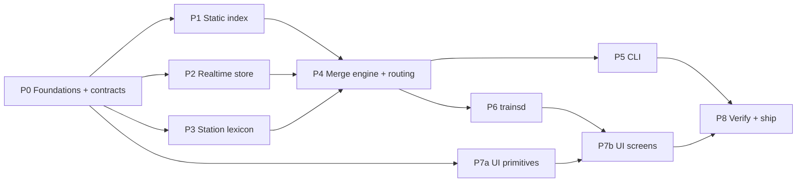

# Implementation Plan — Brisbane Realtime Trains

- **Source of truth:** `SPEC.md`. This plan orders the work and pins the contracts that let it run in parallel; it does not restate design rationale. Section references (§) point into the spec.
- **Toolchain (verified on this machine):** Go 1.26.5 windows/amd64, Node 22.23.2 + npm. No Bun, no `protoc` (not needed — bindings are pre-generated). Binaries build as `trains.exe` / `trainsd.exe` on Windows.
- **Module path:** `trains`. No remote exists yet; renaming later is one `go mod edit -module` plus an import rewrite.

---

## Lanes and dependencies



- **P0 is strictly sequential** and must land first: it freezes the types and the wire contract everything else codes against.
- **After P0, four lanes run in parallel:** P1 static, P2 realtime, P3 lexicon, P7a UI primitives. None depends on another's implementation, only on P0 types.
- **P4 is the integration point** and the highest-risk phase. One owner.
- **P5 and P6 run in parallel** once P4's `Service` API is callable.

---

## P0 — Foundations and frozen contracts

Blocks everything. Small, but every later lane depends on its exact shapes.

| # | Task | Files | Done when |
|---|---|---|---|
| 0.1 | `go mod init trains`, `go 1.26`; add `github.com/MobilityData/gtfs-realtime-bindings/golang/gtfs v1.0.0` | `go.mod`, `go.sum` | `go build ./...` succeeds |
| 0.2 | Public domain types exactly as §3.5: `StopID`, `StationID`, `TripID`, `RouteID`, `ServiceID`, `ShapeID` (distinct string types), `Date`, `Position`, `TimeSource`, `Punctuality`, `Journey`, `Leg`, `Call`, `Change`, `VehicleFix`, `Alert` | `gtfsrail/types.go` | compiles; enums have `String()` |
| 0.3 | JSON wire contract (below) as Go DTOs plus `FromJourney`/`FromLeg` converters, mirrored as TS types. Shared by `trainsd` and `trains --json`, so it lives in the library, not under either command | `gtfsrail/wire/`, `web/src/api/types.ts` | both compile; field names identical |
| 0.4 | `web/` scaffold: Vite + React + TS, `web/embed.go` with `//go:embed all:dist`, committed `web/dist/.gitkeep` | `web/` | `go build ./...` passes with an empty `dist` |
| 0.5 | `cmd/capture`: fetch all three realtime feeds at one instant, write raw `.pb` | `cmd/capture/` | writes `testdata/rt/<ts>/{tu,vp,alerts}.pb` |
| 0.6 | Export the 154 real rail stations (`id,name,lat,lon`) from the current feed, so P3 can test against real names without waiting for P1 | `testdata/stations.csv` | 154 rows; P1.9 later asserts the parser produces the identical set |

The static fixture tool (`cmd/mkfixture`) needs the P1 parser, so it is task 1.9.

### Wire contract (frozen in P0)

Library types stay idiomatic Go (`time.Time`, `time.Duration`). `gtfsrail/wire` converts them to DTOs at the edge, for both `trainsd` and `trains --json`. Conventions: camelCase keys, timestamps as RFC3339 with the `+10:00` offset, durations as integer **seconds**, absent values as `null` — never omitted.

```ts
type Punctuality = 'early' | 'onTime' | 'late' | 'veryLate' | 'skipping' | 'cancelled' | 'scheduled';
type Position    = 'passed' | 'current' | 'upcoming';
type TimeSource  = 'observed' | 'predicted' | 'projected' | 'scheduled';

interface Station    { id: string; name: string; lat: number; lon: number }
interface Call       { stationId: string; name: string; platform: string | null;
                       scheduled: string; expected: string; actual: string | null;
                       position: Position; source: TimeSource; skipped: boolean }
interface VehicleFix { lat: number; lon: number; atSequence: number;
                       status: 'STOPPED_AT' | 'IN_TRANSIT_TO'; observedAt: string; stale: boolean }
interface Alert      { id: string; header: string; description: string;
                       effect: string; cause: string; activeUntil: string | null }
interface Leg        { tripId: string; serviceDate: string /* YYYY-MM-DD */; runNumber: string | null;
                       routeName: string; routeColor: string; headsign: string;
                       calls: Call[]; board: number; alight: number;
                       punctuality: Punctuality; delaySeconds: number;
                       vehicle: VehicleFix | null; alerts: Alert[]; shapeId: string | null }
interface Change     { stationId: string; name: string; bufferSeconds: number; tight: boolean; infeasible: boolean }
interface Journey    { legs: Leg[]; change: Change | null; depart: string; arrive: string; punctuality: Punctuality }

interface JourneysResponse { journeys: Journey[]; generatedAt: string; dataAgeSeconds: number; degraded: boolean }
interface LegResponse      { leg: Leg; generatedAt: string; dataAgeSeconds: number; degraded: boolean }
interface ShapeResponse    { shapeId: string; points: [number, number][] /* [lat, lon] */ }
interface ErrorResponse    { error: 'ambiguous' | 'unknown_station' | 'not_found' | 'bad_request';
                             message: string; candidates?: Station[] }
```

- `ADDED` trips have `shapeId: null` (no static trip to take one from); the UI hides the diagram for them.
- `/api/journeys` with an ambiguous station returns `400` + `ErrorResponse{error:'ambiguous', candidates}` — the UI's disambiguation list is driven by this, not a second endpoint.

---

## P1 — Static rail index (`gtfsrail/internal/gtfs`, `gtfsrail/internal/geo`)

| # | Task | Done when |
|---|---|---|
| 1.1 | `Secs` parser for `H+:MM:SS`, accepting hours ≥ 24 (§2.2: max `26:16:00`) | rejects malformed input; `26:16:00` → 94,560 |
| 1.2 | Streaming CSV reader: header-indexed columns (never positional), CRLF (verified present), **whitespace-trimmed fields** — `stop_lat` is `' -27.470552'` with a leading space in the real feed | parses real `stops.txt` without float errors |
| 1.3 | Filtered pass in dependency order (§3.3); one flat `[]StopTime` backing array with per-trip ranges | counts match §2.1 |
| 1.4 | Station/platform grouping via `parent_station`; `StationOf`, `TripsCalling` inverted index | 154 stations, 359 platforms, 0 orphans |
| 1.5 | `ActiveServices(Date)`: `calendar.txt` weekday + range, then `calendar_dates.txt` add/remove overrides | unit-tested against real rail service rows, including a removal exception |
| 1.6 | `geo.Simplify` — Douglas–Peucker to ≤120 points | 667 shapes simplify; no shape exceeds 120 points; endpoints preserved |
| 1.7 | gob cache: write after parse, keyed by ETag; load path skips CSV entirely | warm load measured and recorded (spec §3.3 target: CLI under 1 s end to end) |
| 1.8 | Fetcher: conditional `GET` with `If-None-Match`, atomic swap via `atomic.Pointer[Index]`, last-check timestamp beside the gob | a second run issues a `304` and reuses the cache |
| 1.9 | `cmd/mkfixture`: `-stats` prints full-feed counts; default mode cuts the fixture below | `-stats` reproduces §2.1 (584 / 9,919 / 248,021 / 154 / 359 / 667); station set equals `testdata/stations.csv`; `testdata/static.zip` committed |

**Fixture contents (1.9)** — real trips with real IDs, chosen so every P4 golden case has the static data it needs:

- the Central→Roma Street services from the §2.6 feasibility run
- a trip with a post-midnight tail (≥ `24:00:00`)
- a Ferny Grove trip and a Cleveland trip, crossing at a shared CBD interchange
- trips through Eagle Junction, Northgate and Boggo Road
- the stations, platforms, calendar rows and simplified shapes they reference

---

## P2 — Realtime store (`gtfsrail/internal/gtfsrt`)

| # | Task | Done when |
|---|---|---|
| 2.1 | Feed fetcher: conditional `GET`, `304` keeps the prior snapshot, per-feed last-success time | `304` path exercised against the live feed |
| 2.2 | Decode to immutable snapshots: TU by `trip_id`; VP by `trip_id`; alerts indexed by `route_id`, `trip_id`, `stop_id` (§2.3 — never `route_type`) | decodes the `cmd/capture` `.pb` files |
| 2.3 | Staleness (§3.4): VP > 120 s → `stale`; TU entirely > 60 min past → dropped; feed > 90 s since success → `degraded` | each threshold unit-tested at its boundary |
| 2.4 | Active-window alert filter: any `active_period` containing now; `ActiveUntil` = end of that window | the 9-window alert from §2.3 resolves correctly |
| 2.5 | Observation table `map[ObsKey]Obs`, upsert per STU per poll, reset at 03:00 Brisbane | rollover unit-tested at 02:59:59 and 03:00:00 |
| 2.6 | **Two run modes:** `Poll(ctx)` (daemon: 15 s / 15 s / 60 s goroutines) and `FetchOnce(ctx, 5s)` (CLI: all three concurrently, §4) | both covered by the P8 smoke runs |
| 2.7 | `Health()`: per-feed last success, age, last error | surfaced at `/api/healthz` |

---

## P3 — Station lexicon (`gtfsrail/internal/stationlex`)

Needs only a list of `(StationID, name)` pairs, so it is built and tested against `testdata/stations.csv` (P0.6) — all 154 real names, so real collisions surface. It does not wait for P1.

| # | Task | Done when |
|---|---|---|
| 3.1 | Normaliser: lowercase, strip trailing ` station`, fold punctuation and whitespace, strip diacritics | |
| 3.2 | Tiered resolve: exact → prefix → word-boundary substring → Levenshtein ≤ 2; first non-empty tier wins; >1 hit → `ErrAmbiguous{Candidates}` | |
| 3.3 | Alias table (§3.7), including `park road` → Boggo Road | |
| 3.4 | `Validate(names)`: every alias target and every interchange name (§3.6) must resolve to exactly one station; violations returned for a loud startup warning | warns, does not crash, if a station is renamed |
| 3.5 | Table test over every §3.7 case | `central`→Central (not Wynnum/Springfield Central), `roma`→Roma Street, `south`→ambiguous ×2, `airport`→ambiguous ×2, `wynnum`→Wynnum, `springfield`→Springfield, `mango hill`→Mango Hill, `romma`→Roma Street, `indro`→Indooroopilly, `park road`→Boggo Road |

---

## P4 — Merge engine and routing (`gtfsrail`)

The integration point and the highest-risk code. **Golden tests are written before or alongside each rule, not after**, because the failure modes (§2.3) are silent: wrong data that looks plausible.

| # | Task | Spec |
|---|---|---|
| 4.1 | Per-leg call resolution, rules 1–6; `Position` and `Source` per call | §3.5 |
| 4.2 | Forward delay propagation past the last STU; `SKIPPED` does not reset the carried delay | §3.5 rules 5–6 |
| 4.3 | Platform from `assigned_stop_id` → `platform_code`, falling back to the scheduled stop | §2.3 |
| 4.4 | Punctuality bands, with `Scheduled` for trips with no realtime entity | §3.5 table |
| 4.5 | `ADDED` synthesis from STUs alone; unknown stop IDs → `Unknown stop <id>` | §3.5 |
| 4.6 | Direct journeys across {yesterday, today, tomorrow}; sort by expected departure; `limit` | §3.5 |
| 4.7 | One-change routing over the 7 validated interchanges; 4-min minimum; `tight` < 5 min; `infeasible` < 4 min after realtime → drop and recompute; direct wins on ties | §3.6 |
| 4.8 | `Service` facade: `Open(Config)` loads the cache or zip, wires the realtime mode, and runs stationlex validation | §3.2 |

**Golden cases (§7), each a named test using `testdata/static.zip` plus a code-built `FeedMessage`:**

1. Trimmed `SCHEDULED` (first STU at seq 29) → earlier calls `Scheduled`; later calls `Projected` with the carried delay.
2. Same trip, observation table pre-seeded from an earlier full update → past calls `Observed`, not `Scheduled`.
3. `REPLACEMENT` with a full stop list → `Observed` past, `Predicted` future.
4. `ADDED` trip → synthesised leg, `shapeId` nil.
5. `SKIPPED` mid-trip → `Skipped=true`; next projected call keeps the pre-skip delay.
6. Unknown stop `600192` → rendered, not dropped, no panic.
7. Vehicle fix 6.1 h old → `stale`; `Position` falls back to time-based rules.
8. Post-midnight trip from the fixture → attributed to the correct service day, and survives the 03:00 reset.
9. No realtime entity → `Scheduled`, never `OnTime`.
10. Two-leg journey; inbound leg delayed to a 3-min buffer → `infeasible`, journey dropped, next pairing chosen.
11. Direct option arriving at the same time as a one-change option → only the direct journey returned.

**Real-world regression:** decode the `cmd/capture` `.pb` snapshot against the full-feed index and assert the reconciliation ratios stay in family with §2.3 (≥ 85% of trip IDs resolve; every `REPLACEMENT` resolves). This catches upstream format drift without pinning exact counts.

---

## P5 — CLI (`cmd/trains`)

| # | Task | Done when |
|---|---|---|
| 5.1 | Flags (§4); exactly two positional args; wrong count → exit 2 with the quoting example | |
| 5.2 | Table renderer: fixed columns, glyph legend, inline `ChangeSummary` for two-leg rows, `○` distinct from `●` | output matches the §4 layout |
| 5.3 | Colour via ANSI, auto-disabled when stdout is not a terminal, or with `--no-color` | piping to a file yields no escape codes |
| 5.4 | `--json` emits `wire.JourneysResponse` — one schema for CLI and HTTP | |
| 5.5 | Exit codes 0 / 1 / 2 (§4); schedule-only banner on realtime failure | verified by running with the network blocked |
| 5.6 | Freshness header: `(live, 7s old)` / `(schedule only)` | |

---

## P6 — Backend (`cmd/trainsd`)

| # | Task | Done when |
|---|---|---|
| 6.1 | Endpoints per §5 with the P0 DTOs and error shape | |
| 6.2 | `Cache-Control` per endpoint (§5) | |
| 6.3 | Serve `web.FS` at `/` with SPA fallback to `index.html` for `/trip/*`; "UI not built" page when `dist` holds only `.gitkeep` | deep link to `/trip/…` loads on refresh |
| 6.4 | `--dev`: CORS for the Vite origin; Vite proxies `/api` in dev, so CORS is a fallback only | |
| 6.5 | Graceful shutdown; pollers bound to the server's context | Ctrl-C exits cleanly |
| 6.6 | Load check (§7): 50 concurrent `/api/journeys` → upstream fetch count unchanged | counted via `Health()` fetch counters |

---

## P7 — UI (`web/`)

### P7a — primitives (parallel with P1–P4; no backend needed)

- **Design tokens** as CSS custom properties: near-black board background, high-contrast foreground, amber/green/red status palette, `font-variant-numeric: tabular-nums` for every time, a monospace stack for times and platforms. `route_color` is injected per row as `--line` and is the only per-route colour.
- **Atoms** (§6.1): `Text`, `Badge`, `StatusDot`, `Spinner`, `TimeLabel`, `Countdown`, `DelayChip`, `PlatformChip`, `LineSwatch`, `Button`, `Input`.
- **Molecules:** `StationPicker` (combobox: keyboard + touch, same tiers as P3 run client-side over `/api/stations`), `JourneyRow`, `ChangeSummary`, `TimelineNode`, `FreshnessIndicator`, `AlertBanner`.
- **Mobile-first:** design at 360 px wide first; touch targets ≥ 44 px; widen to two panes at ≥ 900 px.
- Built against typed fixture objects conforming to `web/src/api/types.ts`, so every state (late, skipped, stale, degraded, tight change) is exercisable before the backend exists.

### P7b — screens (after P6)

- **Data layer:** TanStack Query; 15 s `refetchInterval`, `placeholderData: keepPreviousData`; `fetch` wrapper that maps `ErrorResponse` into typed errors.
- **Routing:** `react-router` — `/` and `/trip/:tripId?date=`. A two-leg journey links to the first leg, with a control to switch to the second.
- **Organisms:** `JourneySearchForm` (swap control, `localStorage` persistence of the last pair), `DepartureBoard` (5 rows, skeletons, empty and ambiguous states), `TripHeader`, `TripTimeline` (Position × Source rendering, §6.3), `LineDiagram`.
- **`LineDiagram`:** fetch `/api/shapes/{id}` once (immutable); equirectangular projection about the centroid into an SVG `viewBox`; station nodes from `calls`; vehicle dot at the nearest point on the polyline to the fix, or time-interpolated and labelled "estimated" when there is no fresh fix. Hidden when `shapeId` is null.
- **Freshness:** always visible; muted palette when `degraded`.
- **Attribution footer:** "Data © Translink, licensed CC BY 4.0."

---

## P8 — Verify and ship

Each item is a run, not a test. Results are recorded in the final report.

1. `go test ./...` and `go vet ./...` clean; `npm --prefix web run build` clean with strict TypeScript.
2. CLI live runs, compared by hand against Translink's journey planner in the same minute:
   - `trains central roma`
   - `trains roma central`
   - `trains indooroopilly central`
   - `trains "ferny grove" cleveland` (must show one-change rows)
   - `trains south central` (must exit 2 listing South Bank and South Brisbane)
3. Cold-start timing: warm-cache `trains central roma` under 1 s, measured.
4. Realtime failure: run with the realtime hosts unreachable → schedule-only banner, exit 1.
5. `trainsd` in a real browser at a 390×844 viewport and at desktop width:
   - pick stations
   - watch the board refresh with no layout shift
   - open a live trip
   - confirm the marker advances across two or more polls and the line diagram renders
   - reload on `/trip/…` and confirm the deep link loads
6. Load check (P6.6).
7. **README:** build (`npm --prefix web ci && npm --prefix web run build && go build ./cmd/...`), run, flags, data attribution, and a short explanation of the merge rules for whoever debugs a wrong time later.

---

## Risks

| Risk | Where it bites | Mitigation |
|---|---|---|
| Delay propagation across trimmed and `SKIPPED` STUs is subtly wrong | P4 — wrong times that look plausible | Golden cases 1, 2, 5 written first; every rule traces to a numbered spec rule |
| Service-day attribution around midnight and the 03:00 reset | P1.5, P2.5, P4.6 | Fixture carries a real post-midnight trip; boundary tests at 02:59:59 and 03:00:00 |
| Upstream drift: renames (Park Road → Boggo Road, ID unchanged), `route_id` version suffixes rolling | P3.4, P4 | Name validation at startup with loud warnings; never key on `route_id` across days; real-capture regression ratios |
| Feed formatting quirks: leading whitespace in coordinates, CRLF, quoted fields | P1.2 | Header-indexed, trimmed reader; verified against the real zip |
| A one-change connection the user cannot actually make | P4.7 | Show the buffer, flag tight connections, drop infeasible ones live — never claim safety |
| A trip with no realtime looks "on time" | P4.4, P5, P7 | `Scheduled` is a distinct state end to end; golden case 9 |
| Realtime look-ahead is only ~50 min | P4.6 | Static schedule is always the spine; realtime only overlays it |
| `go:embed` fails before the first web build | P0.5 | Committed `web/dist/.gitkeep`; "UI not built" fallback page |

## Out of scope (per §0)

Buses, ferries and trams; journeys with two or more changes; historical queries across days; persisting realtime state across restarts; basemap tiles; occupancy, speed and bearing (absent from the feed).
