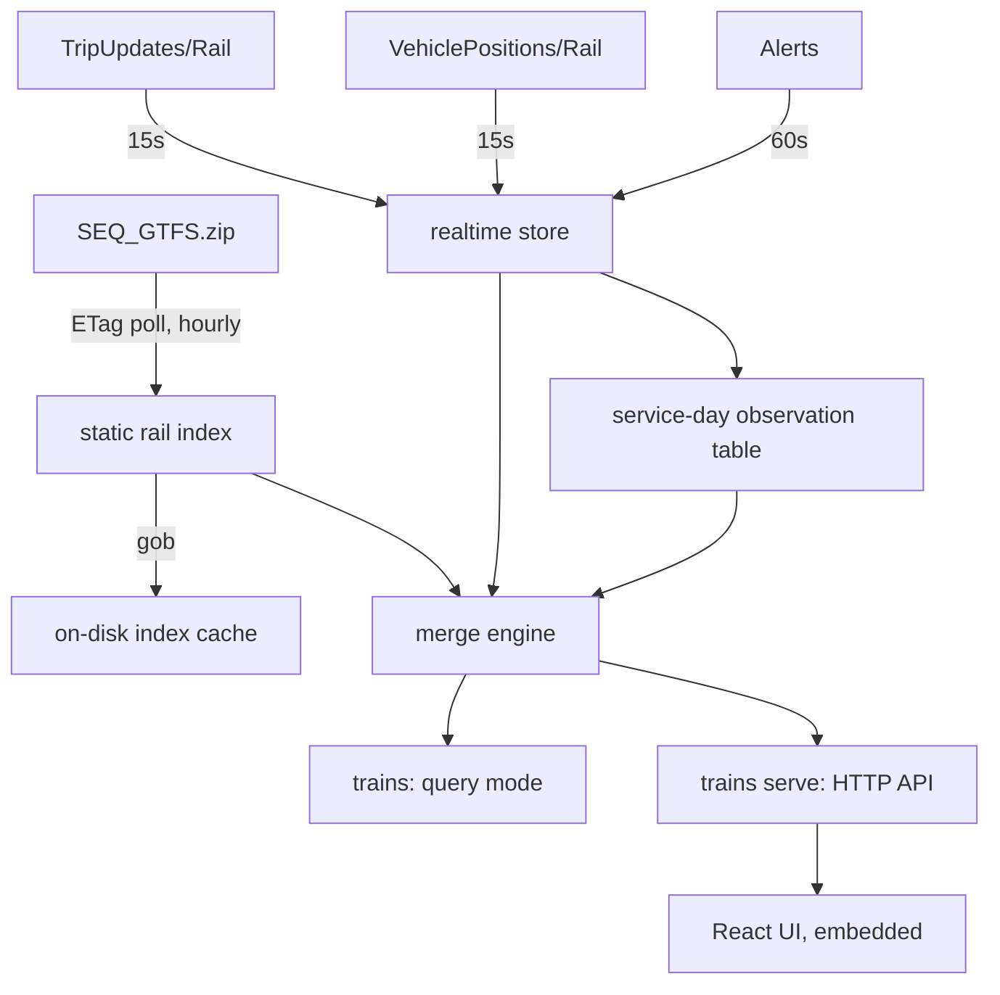

# Brisbane Realtime Trains — Specification

- **Status:** reviewed, decisions locked
- **Date:** 2026-10-22
- **Deliverables:** Go library `gtfsrail` + one `trains` binary (CLI queries by default, HTTP server via `trains serve`) + TypeScript/React/Vite atomic-design UI embedded in that binary
- All numbers below were measured live against the real feeds on 2026-10-22 ~20:00 AEST. Reproduction commands live in `scratch/` (see appendix).

---

## 0. Locked decisions

| Question | Decision |
|---|---|
| Scope | **Rail only** (`route_type=2`) |
| Routing | **Direct + one-change** via a fixed 7-station interchange set |
| Connection time | **Flat 4 min minimum**; always display actual buffer; flag `< 5 min` as tight |
| Journey display | **One row per journey**, change summarised inline |
| Realtime history | **Whole service day in RAM**, cleared at the ~3am rollover (9.1 MB measured worst case) |
| Map | **Timeline + inline SVG line diagram** from `shapes.txt`; no tile provider |
| Deployment | **One Go binary, `trains`**: `trains <from> <to>` queries; `trains serve` runs the HTTP API + embedded UI |
| Purpose | **A tool to actually catch trains** — optimise the daily path |
| Aesthetic | **Departure board** — dark, high contrast, monospaced times, Translink route colours |
| Target | **Mobile-first**, responsive to desktop |
| Verification | **Golden-file tests** on merge engine + station resolver; live smoke test |

**Consequences of "a tool you will actually use", applied throughout:** cold start must be instant (§3.3 binary index cache), home/work stations are remembered (§6.2), and the common case — a CBD-bound commute on a weekday morning — is the one that must never be wrong. Breadth of edge-case handling is secondary to the everyday path being fast and trustworthy.

---

## 1. Data sources (verified live)

### 1.1 Endpoints

- **Static schedule (GTFS):** `https://gtfsrt.api.translink.com.au/GTFS/SEQ_GTFS.zip`
  - 36.7 MB zip. No auth.
  - `Last-Modified: Wed, 21 Oct 2026 19:17:54 GMT`, `ETag: "0x8DF2FA80250FEA8"`, `Cache-Control: public, max-age=1800` → republished roughly daily; conditional GET is supported and MUST be used.
  - `feed_info.txt`: `feed_start_date=20261022`, `feed_end_date=20261221` → a ~2-month horizon per publication.
  - A supplementary variant exists (`.../gtfs/SEQ_SCH_GTFS.zip`, 46.5 MB) adding school services + `agency_id`. **Rejected:** identical rail subset (9,919 rail trips in both) while 27% larger, and the publisher warns its schema is less stable.
- **Realtime rail trip updates:** `https://gtfsrt.api.translink.com.au/api/realtime/SEQ/TripUpdates/Rail`
- **Realtime rail vehicle positions:** `https://gtfsrt.api.translink.com.au/api/realtime/SEQ/VehiclePositions/Rail`
- **Service alerts (all modes, no rail-specific variant):** `https://gtfsrt.api.translink.com.au/api/realtime/SEQ/Alerts`
  - All three returned HTTP 200 `application/x-protobuf`, `Cache-Control: public, max-age=10`.
  - Mode-filtered `/Rail` variants are the right call. Measured same-minute payloads: TripUpdates **822 KB all-mode vs. 156 KB rail** (5.3×), VehiclePositions **86 KB vs. 10.7 KB** (8×) — for identical rail content.

### 1.2 Publication cadence (measured)

- Sampled `Last-Modified` every 6 s for 60 s on VehiclePositions/Rail: values advanced in **10-second steps** (`10:08:20 → 10:08:30 → 10:08:50 → 10:09:00 → 10:09:11 → 10:09:21`).
- **Decision:** poll every **15 s** with `If-None-Match`. Faster adds nothing; the upstream CDN caches for 10 s.

### 1.3 Licence & attribution

- Creative Commons Attribution 4.0 International. No authentication.
- UI and CLI MUST carry: *"Data © Translink, licensed CC BY 4.0."*

---

## 2. Measured data shape (this is what drives the design)

### 2.1 Static feed — the rail subset is small

| Metric | All modes | Rail (`route_type=2`) |
|---|---|---|
| `routes.txt` | 1,166 | **584** |
| `trips.txt` | 146,031 | **9,919** |
| `stop_times.txt` | 3,788,878 rows (213 MB) | **248,021 rows** |
| `stops.txt` | 13,131 | **359 platforms / 154 parent stations** |
| `shapes.txt` | 40.9 MB | 667 shapes, 402,584 points (~8 MB in memory) |
| service IDs | — | 15 |

- **Consequence:** the entire rail index fits comfortably in memory (low tens of MB). No database, no mmap, no streaming query engine.

### 2.2 Static feed quirks that must be handled

- **`route_id` is versioned.** `route_short_name` is a 4-letter origin/destination pair (`BRSH` = Brisbane→Shorncliffe); `route_id` appends a dataset revision (`BRSH-5251`, `BRSH-4997`, …). 584 rail `route_id`s collapse to **64 distinct short names**. Realtime currently references suffixes `5251` (30 routes) and `4997` (5). **Never key on `route_id` across days; key on `route_short_name` for grouping.**
- **There is no "line name" field.** `route_long_name` is `"Ferny Grove - Beenleigh"` style. `route_color` is a *corridor group* colour, not a line colour — `27855A` alone covers Ipswich, Caboolture, Nambour and Gympie North. **Do not invent a line taxonomy.** Display `route_long_name` + `trip_headsign`; use `route_color` verbatim as the accent.
- **Times exceed 24:00:00.** Max rail `departure_time` observed: `26:16:00`; 7,352 rail rows are ≥ `24:00:00`. Times MUST be modelled as *seconds since service-day midnight*, never as wall-clock. (This also fixes the history rollover at 3am — see §3.4.)
- **Platforms vs. stations.** Every rail stop (`location_type=0`) has a `parent_station` (`place_censta`, `place_romsta`, …) — 0 orphans. `platform_code` is populated (Central 1–6, Roma Street 3–10). The user-facing entity is the **parent station**; platform is a per-departure detail.
- **No `transfers.txt`.** Minimum connection times must be invented — see §3.6.
- **`block_id` is empty for all rail trips.** No through-running linkage.
- **Timezone `Australia/Brisbane`, UTC+10, no DST.** Offset is constant year-round. Use `time.LoadLocation` rather than a hardcoded offset, but no DST-boundary logic is required.
- **Station renames happen, and IDs do not follow.** `Park Road station` is now **`Boggo Road station`** — but its `parent_station` ID is still **`place_parsta`**. There is no station with `Park` in its name other than Norman Park, Oxford Park, Trinder Park, Dutton Park and Bray Park. Two consequences: match interchange sets and aliases **by name against the loaded index at startup** (a silent miss would disable interchange routing), and never infer a station's identity from its ID string.
- **Service-day resolution is mandatory.** Rail `calendar.txt` has 15 entries with narrow, overlapping windows (e.g. `QR 26_27-44634-0001000` is Thursday-only, valid `20261022`–`20261022`). 9 `calendar_dates.txt` rows affect rail. A query must evaluate **yesterday, today and tomorrow** as candidate service days.

### 2.3 Realtime feed — snapshot at 2026-10-22T20:03:10+10:00

**TripUpdates/Rail — 120 entities, header `FULL_DATASET`, `gtfs_realtime_version=2.0`**

- `trip.schedule_relationship`: `REPLACEMENT` 81, `SCHEDULED` 26, `ADDED` 13.
- 3,150 `stop_time_update`s (~26/entity). Present: `stop_sequence` 3150/3150, `stop_id` 3150/3150, `arrival` 3079, `departure` 3036, `uncertainty` 3079.
- `stop_time_update.schedule_relationship`: `SCHEDULED` 3070, **`SKIPPED` 80**.
- `stop_time_properties.assigned_stop_id` present on 475 STUs; **differed from `stop_id` in 0 cases**. Honour it anyway (authoritative platform assignment) but do not depend on it.
- `trip.start_date` present 120/120. **`trip.direction_id` present 0/120** → direction MUST come from static `trips.txt`.
- `TripUpdate.delay` (trip-level) present 0/120 → per-stop delays only.

**ID reconciliation**

- Realtime `trip_id` format: `39764460-QR 26_27-44634-D582`. **107/120 resolve in the static feed.**
  - `SCHEDULED` 26/26 matched, `REPLACEMENT` 81/81 matched, `ADDED` 0/13 matched (correct by definition).
- 35/35 realtime `route_id`s matched static.
- 349/353 realtime `stop_id`s matched static. **4 persistent unknowns** — `600192` (`VLBD-5251`), `600350` (`IPBR-5251`), `600464` (`IPCA-5251`), `600470` (`NAIP-5251`) — present in both snapshots, in neither zip. The library MUST render these as `Unknown stop 600192` rather than dropping the call or erroring.

**Entity completeness is NOT uniform — the single most important finding**

| `schedule_relationship` | Count | Full stop list from `stop_sequence=1`? |
|---|---|---|
| `REPLACEMENT` | 81 | **Yes, 81/81** — complete journey including passed stops with actual times |
| `ADDED` | 13 | Yes, 13/13 — but no static counterpart, so it is the *only* source |
| `SCHEDULED` | 26 | **No — 9/26 trimmed**, starting at `stop_sequence` 4, 7, 10, 18, 19, 20, 26, 29, 29 |

- Therefore the merge engine MUST implement the **GTFS-RT partial-update rule** (§3.5). No Go library implements it except `transitland-lib` (§3.1).

**Stale entities are present and must be filtered**

- 13 `ADDED` entities had *all* stop times ~21.5 h in the past (earliest trip start offset `-1292 min`) — yesterday's leftovers still in the feed.
- 46 `REPLACEMENT` entities were already finished.
- **Realtime look-ahead is short:** latest trip start `+50 min` from the feed timestamp; latest stop time `+142 min`.
- **Consequence:** realtime alone CANNOT answer "next 5 trains". Static schedule is the spine; realtime is an overlay.

**VehiclePositions/Rail — 65 entities**

- 65/65 have `trip` (all matched a TripUpdate), `position`, `current_stop_sequence`, `stop_id`, `current_status`, `vehicle.id`, `vehicle.label`.
- **Absent on 65/65:** `bearing`, `speed`, `occupancy_status`, `congestion_level`. Do not design affordances needing them.
- `current_status`: `IN_TRANSIT_TO` 38, `STOPPED_AT` 27.
- **`vehicle.label` == the `trip_id` suffix in 65/65 cases** (trip `…-1776`, label `1776`) — the QR run number. Display as "Run 1776".
- **Coverage is partial: 65 of 120 trip updates had a vehicle position.**
- **Vehicle timestamps go stale:** median age vs. feed header `-5 s` (vehicle clock slightly ahead), **max 22,102 s (6.1 h)**. Entries beyond threshold MUST be marked stale and excluded from live positioning.
- Churn over 320 s: 46/65 positions moved, 41/65 changed `current_stop_sequence`.

**Alerts — 102 entities, 16 touch rail**

- Alerts target `informed_entity.route_id` (never `route_type` — a `route_type==2` filter matched 0). 63 alerts are stop-only. Rail matching MUST be: `route_id ∈ rail routes` OR `trip.trip_id ∈ known rail trips` OR `stop_id ∈ rail platforms`.
- One alert named **584 route IDs** (the "Reduced train timetables" strike notice). Index alerts by route; never scan linearly per departure.
- Rail effects: `REDUCED_SERVICE` 15, `MODIFIED_SERVICE` 1. Causes: `MAINTENANCE`, `STRIKE`, `CONSTRUCTION`.
- `active_period` is a *list* (one alert carried 9 windows). Filter on "any window contains now".

### 2.4 Interchange candidates (measured)

Trips calling at each station, of 9,919 rail trips/day, with distinct origin–destination route codes as a proxy for interchange value:

| Station | Trips | % | Route codes |
|---|---|---|---|
| Bowen Hills | 9,025 | 91.0% | 49 |
| Roma Street | 9,015 | 90.9% | 49 |
| Central | 9,015 | 90.9% | 49 |
| Fortitude Valley | 9,015 | 90.9% | 49 |
| Eagle Junction | 6,522 | 65.8% | 36 |
| Northgate | 4,591 | 46.3% | 30 |
| Boggo Road | 4,357 | 43.9% | 22 |
| South Brisbane / South Bank | 4,357 | 43.9% | 22 |
| Albion | 4,165 | 42.0% | 26 |

- 9,015 of 9,919 trips call at both Central and Roma Street (4,444 Central→Roma, 4,571 Roma→Central) — Brisbane rail is radial through the CBD, so most real queries are direct.

### 2.5 History storage cost (measured)

Decoding the live rail TripUpdates feed 20× and measuring heap delta:

```
wire bytes: 148,910      decoded protobuf snapshot: 1,096,458 bytes (7.4x wire)

                        naive snapshot ring    de-duplicated per-trip
  1h  (240 polls)            263 MB                   0.5 MB
  3h  (720 polls)            789 MB                   1.4 MB
 24h  (5760 polls)         6,316 MB                   9.1 MB
```

- Observations are idempotent: a stop's actual time is written once, then stops changing. Keyed by `(trip, stop_sequence)` at 32 bytes each, **a whole service day is 248,021 observations = 9.1 MB.** A sliding window saves 7.7 MB and buys nothing, so we keep the full day.

### 2.6 End-to-end feasibility: proven

A throwaway script (`scratch/feasibility.py`) already answers both product questions against the live feed:

```
Central station -> Roma Street station, feed ts 2026-10-22T20:04:10+10:00
  1778  sched 20:04  rt 20:04  plat 2   Ferny Grove - Beenleigh (Beenleigh station)   ON TIME [REPLACEMENT]  @-27.4665,153.0244 seq15 IN_TRANSIT_TO
  DK78  sched 20:13  rt 20:13  plat 5   Redcliffe Peninsula - Springfield             ON TIME [REPLACEMENT]  @-27.4265,153.0419 seq19 IN_TRANSIT_TO
  1890  sched 20:17  rt 20:18  plat 2   Shorncliffe - Cleveland (Cleveland station)   LATE 67s [REPLACEMENT] @-27.4158,153.0479 seq13 IN_TRANSIT_TO
  JRA8  sched 20:22  rt 20:22  plat 2   Doomben - Brisbane City (Roma Street station) ON TIME [SCHEDULED]    @-27.4196,153.0595 seq4  STOPPED_AT
  D578  sched 20:28  rt 20:28  plat 5   Caboolture - Ipswich (Ipswich station)        ON TIME [REPLACEMENT]  @-27.3505,153.0302 seq7  IN_TRANSIT_TO
```

```
timeline, trip 39764967-…-TE95 (Beenleigh→Ferny Grove), run TE95, IN_TRANSIT_TO seq 29
  >> seq29  Windsor station      20:05:28   +1.3 min   delay +28s
     seq30  Wilston station      20:07:34   +3.4 min   delay +34s
     …
     seq39  Ferny Grove station  20:27:34  +23.4 min   delay +34s
```

---

## 3. Architecture



### 3.1 Dependencies

- **Static GTFS: hand-rolled** `archive/zip` + `encoding/csv`. Every surveyed library loads all 146k trips / 3.8M stop_times before rail filtering is possible, costing ~150–250 MB of heap for a 9,919-trip answer; none expose `route_type` filtering during parse. Our streaming filter is ~150 lines.
- **Realtime: `github.com/MobilityData/gtfs-realtime-bindings/golang/gtfs v1.0.0`** (Apache-2.0, one transitive dep: `google.golang.org/protobuf`). Verified against all three live feeds.
- **Rejected:** `interline-io/transitland-lib` is the only library implementing delay propagation and `assigned_stop_id` matching, but costs ~426 transitive deps, cgo (SQLite) and a GPLv2 obligation. `jamespfennell/gtfs` / `OneBusAway/go-gtfs` are clean (MIT, 5 deps) but load everything and still leave delay propagation to us.
- **Standard library otherwise.** `net/http` + `encoding/json`. No web framework.
- Frontend: Vite + React + TypeScript, TanStack Query for polling. No component library — atomic design means we own the primitives.

### 3.2 Layout

```
gtfsrail/                      public library: Service, Journeys, Leg, Stations, Resolve + domain types
gtfsrail/internal/gtfs/        static zip parse → rail index, gob cache
gtfsrail/internal/gtfsrt/      realtime poll + decode + observation table
gtfsrail/internal/stationlex/  fuzzy station name resolution
gtfsrail/internal/geo/         Douglas–Peucker shape simplification (projection is the UI's job, §6.3)
cmd/trains/                    the one binary: argument dispatch only
cmd/trains/query/              query mode: flags, table renderer, exit codes
cmd/trains/serve/              serve mode: HTTP handlers, static UI, shutdown
web/                           Vite + React + TS; web/embed.go exposes the build as embed.FS
```

- `gtfsrail` is the library both modes consume, and the only package importable outside the module. The merge engine (§3.5) lives in it directly — it *is* the library's value. Parsing and polling are implementation details behind `internal/`.
- Query and serve modes live in separate packages, so each can be built and tested independently; `cmd/trains/main.go` does nothing but dispatch (§4.1).
- `//go:embed` cannot reach parent directories, so the embed lives in `web/embed.go` (`package web`, `//go:embed all:dist`). `web/dist/.gitkeep` is committed so `go build` succeeds before the first frontend build; `trains serve` serves a "UI not built" page in that case.
- Embedding the UI does not slow queries: `embed.FS` data sits in the binary's read-only data section and is paged in only when a file is served.

### 3.3 `gtfsrail/internal/gtfs` — static rail index

- Single streaming pass over the zip in dependency order: `routes.txt` (keep `route_type==2`) → `trips.txt` (keep matching `route_id`) → `stops.txt` (all; needed for `parent_station`) → `stop_times.txt` (keep matching `trip_id`) → `shapes.txt` (keep rail `shape_id`s) → `calendar.txt`, `calendar_dates.txt`, `feed_info.txt`.
- **Shapes are included** (line diagram, §6.3). 667 rail shapes / 402,584 points (mean 603 per shape). Each is simplified once at index time with Douglas–Peucker to ≤120 points — enough for an SVG polyline, ~80% fewer points.

```go
type StopTime struct {
    StopID    StopID
    Seq       uint16
    Arrival   Secs // seconds since service-day midnight; may exceed 86400
    Departure Secs
}

type Trip struct {
    ID        TripID
    RouteID   RouteID
    ServiceID ServiceID
    ShapeID   ShapeID
    Headsign  string // "Beenleigh station"
    Direction uint8
    StopTimes []StopTime // sorted by Seq
}

type Station struct { // parent_station, location_type=1
    ID        StopID  // "place_censta"
    Name      string  // "Central station"
    Lat, Lon  float64
    Platforms []StopID
}

type Index struct{ /* ... */ }

func (*Index) Station(StopID) (*Station, bool)
func (*Index) StationOf(platform StopID) (*Station, bool)
func (*Index) Stations() []*Station
func (*Index) Trip(TripID) (*Trip, bool)
func (*Index) ActiveServices(Date) map[ServiceID]bool
func (*Index) TripsCalling(StopID) []TripID // precomputed inverted index
func (*Index) Shape(ShapeID) []geo.Point    // simplified polyline
```

- Stop times live in one flat `[]StopTime` with per-trip `[start:end)` slices — 9,919 slice headers, one backing array.
- **Cold start is a product requirement.** After a successful parse the index is written to `os.UserCacheDir()/trains/index-<etag>.gob` (`%LocalAppData%` on Windows, `$XDG_CACHE_HOME` or `~/.cache` on Linux). A subsequent CLI invocation or daemon start loads the gob instead of re-reading a 213 MB `stop_times.txt`. Size is an estimate until built — 248,021 stop times plus ≤80,040 simplified shape points suggests low single-digit MB. Target: `trains central roma` returns in under a second from a warm cache.
- **Refresh:** conditional `GET` hourly. On change, build a new `*Index` off to the side and swap behind `atomic.Pointer[Index]`. Readers never block.

### 3.4 `gtfsrail/internal/gtfsrt` — realtime store and observation table

- One goroutine per feed; 15 s for TripUpdates + VehiclePositions, 60 s for Alerts. Conditional GET; on `304`, retain the previous snapshot and age it.
- Snapshots are immutable, published via `atomic.Pointer`.
- **Staleness policy** (from §2.3):
  - Vehicle position usable if `header_ts - vehicle.timestamp ≤ 120 s`; otherwise `stale`, excluded from live positioning.
  - Trip update dropped if every stop time is > 60 min in the past.
  - If the last successful fetch is > 90 s old, derived fields are marked `degraded` and both UI and CLI say so rather than implying live data.

**Observation table (the history decision)**

```go
type ObsKey struct { Trip TripID; Seq uint16 }
type Obs struct {
    ArrTime, DepTime   int64  // unix seconds, 0 = unobserved
    ArrDelay, DepDelay int32
    Skipped            bool
}
// map[ObsKey]Obs, one entry per observed call, 32 bytes payload
```

- On every TripUpdate poll, upsert one entry per STU. Writes are idempotent; a stop's actual time stabilises once passed.
- **Retention: the whole service day**, cleared at the 03:00 rollover. 03:00 is safe because the latest rail stop time observed is `26:16:00` (02:16 next day), so no live trip spans the reset.
- Measured ceiling 9.1 MB (§2.5). No disk, no schema, no eviction policy beyond the daily reset.
- Rationale: 9 of 26 `SCHEDULED` entities arrive trimmed, losing their past calls mid-journey. The table preserves what we already observed, so "where the train has been" stays real rather than degrading to scheduled times.
- Lost on restart. Acceptable: the only casualty is actuals for trips already in progress, and in-progress trips self-heal within a poll or two from `REPLACEMENT`/`ADDED` entities that carry their full history anyway.

### 3.5 `gtfsrail` merge engine — the only interesting logic

**Resolution order for a stop's realtime time:**

1. Observation table entry for `(trip, seq)` — the strongest evidence, since it survives feed trimming.
2. STU matched by `stop_sequence` (present 3150/3150).
3. STU matched by `stop_id`, then `stop_time_properties.assigned_stop_id`.
4. No coverage, *before* the first STU → static schedule, source `Scheduled`.
5. No coverage, *after* the last STU → static schedule **+ last observed delay**, source `Projected`.
6. `SKIPPED` → `Skipped=true`; its times are unusable and it does **not** reset the propagated delay.

**Every call carries two independent facts** — where it sits relative to the train, and how we know its time:

| `Position` | Rule |
|---|---|
| `Passed` | fresh vehicle fix: `seq < AtSequence`; otherwise expected departure `< now` |
| `Current` | fresh vehicle fix: `seq == AtSequence` (the stop it is at, or heading to); otherwise the first call not yet passed |
| `Upcoming` | everything after `Current` |

| `Source` | Meaning |
|---|---|
| `Observed` | passed, with an actual time from realtime or the observation table |
| `Predicted` | not yet passed, with a time from a live STU |
| `Projected` | not yet passed, static time + forward-propagated delay (rule 5) |
| `Scheduled` | static time only — no realtime evidence either way (rule 4, or no entity at all) |

**Punctuality** (delay seconds, from `departure.delay` at the origin, falling back to `arrival.delay`):

| Band | Label |
|---|---|
| `delay < -60` | `Early` |
| `-60 ≤ delay ≤ 59` | `OnTime` |
| `60 ≤ delay < 300` | `Late` |
| `delay ≥ 300` | `VeryLate` |
| STU `SKIPPED` at origin | `Skipping` |
| alert `effect=NO_SERVICE` covering the trip | `Cancelled` |
| no realtime entity | `Scheduled` (explicitly *not* "on time") |

> The `Scheduled` / `OnTime` distinction is load-bearing. 55 of 120 live trips had no vehicle position, and far more of the day's 9,919 trips have no realtime entity at all. Claiming "on time" for a train we have no data about is the obvious failure mode of this class of app and we will not ship it.

**Core API:**

```go
// Next journeys from origin to destination: direct trips, plus one-change
// options when they beat or fill gaps in the direct service.
func (s *Service) Journeys(ctx context.Context, origin, dest StationID, at time.Time, limit int) ([]Journey, error)

// Full stop-by-stop detail for one leg on one service date.
func (s *Service) Leg(ctx context.Context, trip TripID, date Date) (*Leg, error)

type Journey struct {
    Legs        []Leg       // 1 = direct, 2 = one change
    Change      *Change     // nil when direct
    Depart      time.Time   // expected departure of leg 1
    Arrive      time.Time   // expected arrival of the final leg
    Punctuality Punctuality // worst across legs
    DataAge     time.Duration
    Degraded    bool
}

type Change struct {
    Station   StationID
    Name      string
    Buffer    time.Duration // live: arrival of leg 1 → departure of leg 2
    Tight     bool          // Buffer < 5 min
    Infeasible bool         // Buffer < 4 min after realtime applied
}

type Leg struct {
    TripID       TripID
    ServiceDate  Date
    RunNumber    string      // vehicle.label, e.g. "1776"
    RouteName    string      // route_long_name
    RouteColor   string      // "#D53E45"
    Headsign     string
    Calls        []Call      // every stop, seq order
    Board, Alight int        // indices into Calls
    Punctuality  Punctuality
    DelaySeconds int32
    Vehicle      *VehicleFix // nil when unknown
    Alerts       []Alert
    ShapeID      ShapeID
}

type Call struct {
    Station   StationID
    Name      string
    Platform  string     // from assigned_stop_id → platform_code
    Scheduled time.Time
    Expected  time.Time  // == Scheduled when no realtime
    Actual    *time.Time // set once passed and observed
    Position  Position   // Passed | Current | Upcoming
    Source    TimeSource // Observed | Predicted | Projected | Scheduled
    Skipped   bool       // STU SKIPPED: the train will not stop here
}

type VehicleFix struct {
    Lat, Lon   float64
    AtSequence uint16
    Status     string // STOPPED_AT | IN_TRANSIT_TO
    ObservedAt time.Time
    Stale      bool
}

type Alert struct {
    ID            string
    Header        string
    Description   string
    Effect        string     // REDUCED_SERVICE | MODIFIED_SERVICE | NO_SERVICE | …
    Cause         string     // MAINTENANCE | STRIKE | CONSTRUCTION | …
    ActiveUntil   *time.Time // end of the active window containing now; nil = open-ended
}

// Date is a service date in Australia/Brisbane. Stdlib-only, so no civil package.
type Date struct {
    Year  int16
    Month time.Month
    Day   uint8
}
```

- **Direct candidates:** intersect `TripsCalling(origin)` with `TripsCalling(dest)`, require `seq(origin) < seq(dest)`, across service days `{yesterday, today, tomorrow}` to catch the `26:16:00` tail. With a prebuilt `map[StationID][]TripID` this is a set intersection over a few thousand IDs.
- **`ADDED` trips** have no static trip. Synthesise a `Leg` from the STU list alone; station names resolve from `stop_id`, degrading to `Unknown stop <id>` for the four known-unknown IDs. They appear in results like any other.

### 3.6 One-change routing

- **Interchange set (fixed, validated at startup):** Bowen Hills, Roma Street, Central, Fortitude Valley, Eagle Junction, Northgate, Boggo Road.
  - Resolved by name against the loaded index on boot. A rename (as already happened to Park Road → Boggo Road) logs a loud warning rather than silently disabling interchange routing.
- **Algorithm:** for each interchange `X` not equal to origin or destination, find the next direct legs `origin → X` and `X → dest`, pair them where `depart(leg2) ≥ arrive(leg1) + 4 min`, and keep the pairing with the earliest arrival per interchange. Seven interchanges × two direct lookups is cheap enough to run on every query.
- **Minimum connection time: flat 4 minutes**, applied uniformly. We have no `transfers.txt` and will not pretend to model platform geometry.
- **The buffer is always displayed**, and anything under 5 minutes is flagged `tight`. As realtime erodes it — a late inbound train — the buffer shrinks live and flips to `tight`, then `infeasible` below 4 min, at which point the journey is dropped and recomputed. This puts the judgement with the user instead of us asserting a connection is safe.
- **Direct always wins on ties.** One-change results only appear when they arrive earlier than a direct option, or when no direct service exists in the window. If neither exists: `no service found` with the next direct departure time, however far out.

### 3.7 `gtfsrail/internal/stationlex` — "central" → Central station

Measured ambiguity in the real 154-station set:

- `"central"` → exact-token hit `Central station`, but substring also hits `Wynnum Central`, `Springfield Central`.
- `"roma"` → prefix-unique `Roma Street station`.
- `"south"` → ambiguous: `South Brisbane`, `South Bank`.
- `"airport"` → ambiguous: `Domestic Airport`, `International Airport`.
- Genuine prefix collisions: `Mango Hill` ⊂ `Mango Hill East`, `Springfield` ⊂ `Springfield Central`, `Wynnum` ⊂ `Wynnum Central` / `Wynnum North`.

**Rules, in order; first non-empty tier wins:**

1. Normalise: lowercase, strip trailing `" station"`, collapse punctuation and whitespace, strip diacritics.
2. Exact normalised equality — makes `central` → `Central station` and `wynnum` → `Wynnum station` unambiguous despite longer neighbours.
3. Prefix match.
4. Word-boundary substring match.
5. Levenshtein distance ≤ 2 against both the full normalised name and its first *N* words, where *N* is the query's word count. The word-prefix comparison is required: `romma` is distance 7 from `roma street` but 1 from `roma`. Verified against all 154 names: `romma`, `indooroopily`, `centrl`, `bowen hils`, `nortgate`, `ipswitch`, `cabolture` each resolve to exactly one station.

- A tier yielding exactly one station resolves. Several → `ErrAmbiguous` carrying candidates, so the CLI prints `ambiguous: "south" matches South Bank station, South Brisbane station` and the UI renders a disambiguation list.
- Curated aliases, justified by local usage rather than invented: `roma st`→Roma Street, `fortitude`→Fortitude Valley, `indro`→Indooroopilly, `domestic`/`int airport`→the Airport stations, `park road`→Boggo Road (the rename).

---

## 4. The `trains` binary

One binary, two modes, chosen by the first argument. The everyday action is the bare command; the long-running mode is a named subcommand — the same split as `deno script.ts` / `deno run` and `hugo` / `hugo server`.

```
trains <origin> <destination> [query flags]
trains serve [serve flags]
```

### 4.1 Dispatch

- If the first argument is exactly `serve`, run serve mode with the remaining arguments. Otherwise run query mode with all arguments.
- Subcommand names are matched **before** station names, exact and case-sensitive. No station normalises to `serve` today. The binary passes its reserved subcommand names to the startup validation (§3.7, `Validate`), which warns if any station or alias would collide — so a future rename cannot silently become unreachable. The lexicon itself knows nothing about the CLI.
- Each mode owns its flag set. A flag passed to the wrong mode is an error with a pointer to the right one (`--addr is a serve flag: trains serve --addr …`), not silently ignored.
- No arguments prints both usage lines and exits `2`. An explicit `-h` / `--help` prints the same and exits `0`.
- Flags may appear before, between or after the station names (`trains central roma --json`). Go's `flag` package stops at the first non-flag argument, so query mode parses iteratively: parse, take the next positional, resume parsing on the rest.

### 4.2 Query mode — `trains <origin> <destination>`

```
  -n, --count int       journeys to show (default 5)
      --at string       query time, RFC3339 or HH:MM (default now)
      --direct          suppress one-change options
      --json            emit JSON instead of a table
      --no-color        disable ANSI colour
      --cache string    index cache dir (default os.UserCacheDir()/trains)
```

`trains central roma`:

```
Central station → Roma Street station        Thu 22 Oct, 20:04 AEST  (live, 7s old)

  DEPART  PLAT  ARRIVE  STATUS        SERVICE                               RUN
  20:04   2     20:07   ● on time     Ferny Grove – Beenleigh → Beenleigh   1778
  20:13   5     20:16   ● on time     Redcliffe Pen. – Springfield          DK78
  20:18   2     20:21   ▲ 1 min late  Shorncliffe – Cleveland → Cleveland   1890
  20:22   2     20:25   ● on time     Doomben – Brisbane City → Roma St     JRA8
  20:28   5     20:31   ○ scheduled   Caboolture – Ipswich → Ipswich        —

  ● on time   ▲ late   ▼ early   ○ no realtime   ✕ cancelled/skipped
  Data © Translink, CC BY 4.0
```

One-change journeys only appear when no direct option arrives sooner (§3.6), so they never show for Central→Roma Street. They do for `trains "ferny grove" cleveland` — the feed has no `FG↔CL` route code, only `FGBN`, `FGBR`, `BNFG`, `BRFG`. Each journey occupies a single row with the change summarised inline (times and run numbers illustrative):

```
  DEPART  PLAT  ARRIVE  STATUS        SERVICE                               RUN
  20:11   1     21:02   ▲ 2 min late  via Bowen Hills · 7 min change        1780 → 1892
  20:41   1     21:30   ⚠ tight       via Central · 4 min change            1782 → D894
```

- `○ scheduled` is a distinct glyph from `● on time`, per §3.5.
- Exactly two positional arguments. Multi-word stations are quoted: `trains "ferny grove" cleveland`. Any other count exits `2` with that example in the message.
- Exit codes: `0` success; `2` usage error, or ambiguous/unknown station (with candidates / nearest three suggestions); `1` feed unreachable — but the scheduled timetable still prints from cache under a `schedule only — realtime unavailable` banner.
- Cold start reads the gob index cache (§3.3), not the zip.
- **No pollers in query mode.** It fetches the three realtime feeds once, concurrently, with a 5 s overall timeout, answers, and exits. The observation table is therefore empty. That only affects calls a train has already passed, which a departure board never shows. Past the timeout, the board prints in schedule-only mode (exit `1`, as above).
- The static index refreshes on query runs too: a conditional `GET` at most hourly, tracked by a timestamp beside the gob. A `304` costs one round trip; a changed feed is re-parsed before answering.

### 4.3 Shared cache between modes

- Both modes read and write the same `os.UserCacheDir()/trains` index, so a query run while `trains serve` is up reuses the server's freshly parsed index and vice versa.
- Writes go to a temp file in the same directory, then rename into place, so no process ever reads a half-written index. On Windows the rename fails while another process holds the file open; the writer retries briefly, then keeps the previous cache and logs it. Readers open, read fully, and close immediately to keep that window small.

---

## 5. Serve mode — `trains serve`

```
      --addr string     listen address (default localhost:8080)
      --dev             enable CORS for the Vite dev server origin
      --cache string    index cache dir (default os.UserCacheDir()/trains)
```

- Defaults to `localhost` so nothing is exposed by accident. To use the mobile-first UI from a phone on the same network, bind explicitly: `trains serve --addr :8080`.
- `net/http`, JSON, Vite build served from `embed.FS` at `/`. Same `gtfsrail.Service` as query mode — no logic duplicated, no CORS in production.
- Exit codes: `0` on clean shutdown (Ctrl-C / SIGTERM); `1` if the address cannot be bound or startup fails.

| Method | Path | Returns |
|---|---|---|
| `GET` | `/api/stations` | all 154 stations `{id, name, lat, lon}` — cacheable for a day, enables client-side filtering |
| `GET` | `/api/journeys?origin=&destination=&limit=5&at=&direct=` | `{journeys: Journey[], generatedAt, dataAge, degraded}` |
| `GET` | `/api/legs/{tripId}?date=YYYY-MM-DD` | `{leg: Leg}` — every call with scheduled/expected/actual plus the live vehicle fix |
| `GET` | `/api/shapes/{shapeId}` | simplified polyline for the line diagram; immutable, `max-age=86400` |
| `GET` | `/api/healthz` | per-feed last-success timestamp and age |

- Every payload carries `generatedAt` and `dataAge` so the UI renders truthful freshness rather than implying live data.
- `Cache-Control: no-store` on journeys/legs; `max-age=3600` on stations; `max-age=86400` on shapes.
- Background polling runs on a fixed cadence regardless of request volume: N concurrent browsers cause exactly 4 upstream requests per minute, not 4N.
- `/api/*` never falls back to the UI: an unknown API path returns a JSON `404` (`ErrorResponse`), not `index.html` with a `200`. The `index.html` fallback applies only to UI routes (`/`, `/trip/*`).
- In development the Vite dev server proxies `/api` to `trains serve`, so the frontend uses the same relative paths in both setups; `--dev` CORS is only a fallback.

---

## 6. UI — Vite + React + TypeScript, atomic design

**Departure-board aesthetic, mobile-first.** Dark background, high contrast, tabular monospaced numerals for times, Translink `route_color` as the only chromatic accent. Single column on phones, widening to a two-pane layout on desktop. Large touch targets; readable at arm's length on a platform.

### 6.1 Atomic inventory

- **Atoms:** `Text`, `Badge`, `StatusDot`, `Spinner`, `TimeLabel` (tabular numerals), `Countdown`, `DelayChip`, `PlatformChip`, `LineSwatch` (`route_color` verbatim), `Button`, `Input`.
- **Molecules:** `StationPicker` (combobox over `/api/stations`, same tiered matching as §3.7, keyboard + touch), `JourneyRow`, `ChangeSummary` (`via Bowen Hills · 7 min change`, tight-state styling), `TimelineNode`, `FreshnessIndicator`, `AlertBanner`.
- **Organisms:** `JourneySearchForm` (two `StationPicker`s + swap), `DepartureBoard`, `TripTimeline`, `LineDiagram`, `TripHeader`.
- **Templates:** `SearchTemplate`, `TripTemplate`.
- **Pages:** `DeparturesPage` (`/`), `TripPage` (`/trip/:tripId?date=`).

### 6.2 Screen 1 — Departures

- Two `StationPicker`s with a swap control. **Selection persists to `localStorage`** so the daily commute survives a reload and the app opens ready to answer.
- `DepartureBoard` renders 5 `JourneyRow`s: departure time, countdown (`in 3 min`), platform, punctuality dot + delay, route name, headsign, run number. One-change journeys get a `ChangeSummary` on the same row.
- Polls `/api/journeys` every 15 s via TanStack Query with `keepPreviousData` — no flicker, no layout shift.
- `FreshnessIndicator` always visible. On `degraded`, rows mute and read "schedule only".
- Tapping a row routes to `/trip/:tripId?date=`; a one-change journey offers both legs.

### 6.3 Screen 2 — Trip timeline

- Vertical timeline, one `TimelineNode` per call (observed max 44 stops; 39 in the sample trip).
- Each node: station name, platform, scheduled time, expected time when it differs, and a signed offset (`+34s`, `−2 min`).
- Node rendering maps from `Call.Position` × `Call.Source` (§3.5):
  - **Passed** — filled dot, solid rail above; shows the actual time when `Source=Observed`, otherwise the scheduled time marked "not observed".
  - **Current** — pulsing marker. `STOPPED_AT` snaps onto the node; `IN_TRANSIT_TO` sits fractionally between previous and current.
  - **Upcoming** — hollow dot, dashed rail. `Predicted` renders plainly; `Projected` and `Scheduled` carry a subtle "estimated" affordance, since neither is a live prediction for that stop.
  - **Skipped** (any position) — struck through with a "not stopping" badge (80 such STUs in one snapshot; a real and frequent state).
- **`LineDiagram`:** inline SVG polyline from the trip's simplified shape (§3.3), stations as nodes, the vehicle as a dot positioned on the path. Equirectangular projection about the shape's centroid — adequate at Brisbane's latitude over a ≤100 km route, and it avoids a projection library. No tiles, no basemap, no third-party dependency, no API key.
- **Live progress:** with a fresh `VehicleFix`, place the marker by nearest point on the shape polyline. Without one, interpolate on time between surrounding expected times and label the marker "estimated". No `speed` or `bearing` field exists, so no velocity prediction is possible — we will not fake one.
- Header: route name, headsign, run number, overall punctuality, active alerts.
- Polls `/api/legs/{tripId}` every 15 s. The marker animates via CSS transition between polls; it does **not** dead-reckon.

---

## 7. Verification

**Golden-file tests, no network in CI.** Three fixture kinds, because a real capture cannot be relied on to contain every edge case at the moment it is taken:

- **Static:** a small `testdata/static.zip` generated from the real feed by a `cmd/mkfixture` dev tool — a handful of real trips (including a `26:16:00` post-midnight tail and both sides of each interchange) with their stops, calendar rows and shapes, all IDs preserved.
- **Realtime, edge cases:** `FeedMessage`s built in Go test code, one per case below, using real IDs from the static fixture. Deterministic and self-describing.
- **Realtime, real-world:** raw `.pb` snapshots of all three feeds taken at the same instant by a `cmd/capture` dev tool, stored in `testdata/`. They guard against decode and reconciliation regressions on real data. The `scratch/rt*.json` dumps are research evidence only — `omitempty` dropped zero-valued delays, so they are not faithful enough to test against.

Merge-engine cases, each drawn from a real observation above:

- trimmed `SCHEDULED` update (min seq 29 of 39) → forward delay propagation + static backfill
- same trip, after an earlier full snapshot → observation table supplies the real past, not scheduled times
- `REPLACEMENT` with a full stop list → realtime passthrough
- `ADDED` trip with no static counterpart → synthesised leg
- `SKIPPED` STU → `Skipped` status, propagated delay not reset
- unknown `stop_id` `600192` → renders as `Unknown stop 600192`, no panic, call not dropped
- vehicle fix 6.1 h stale → excluded; falls back to time interpolation
- post-midnight trip at `26:16:00` → correct service-day attribution, survives the 03:00 history rollover
- no realtime entity → `Scheduled`, never `OnTime`
- one-change pairing where realtime erodes the buffer below 4 min → journey dropped and recomputed

**Station resolver table test** across every ambiguity in §3.7, including the `park road` → `Boggo Road` alias.

**Live smoke test — the actual proof of delivery:**

- `./trains central roma`, `./trains roma central`, `./trains indooroopilly central`, and a pair requiring a change such as `./trains "ferny grove" cleveland`; compare each against Translink's journey planner for the same minute.
- Run `trains serve`, drive both screens in a real browser at mobile viewport, confirm the timeline marker advances across successive polls and the line diagram renders.
- Cold-start timing: `trains central roma` from a warm index cache must return in under a second.

**Load check:** 50 concurrent `/api/journeys` requests produce zero additional upstream fetches.

---

## Appendix — research artifacts

| Path | Purpose |
|---|---|
| `scratch/rtprobe/main.go` | field-population census over the three live feeds |
| `scratch/rtprobe/cmd/dump/main.go` | protobuf → JSON snapshot dumper (source of `rt.json`, `rt2.json`) |
| `scratch/rtprobe/cmd/memsize/main.go` | heap measurement behind the 9.1 MB history figure |
| `scratch/analyze.py` | rail subset sizing, station enumeration |
| `scratch/match.py` | static↔realtime ID reconciliation, staleness, alert matching |
| `scratch/names.py` | station naming ambiguity, calendar, platform structure |
| `scratch/feasibility.py` | end-to-end proof: next-5 query + live trip timeline |
| `scratch/interchange.py` | interchange call-frequency ranking (§2.4) |
